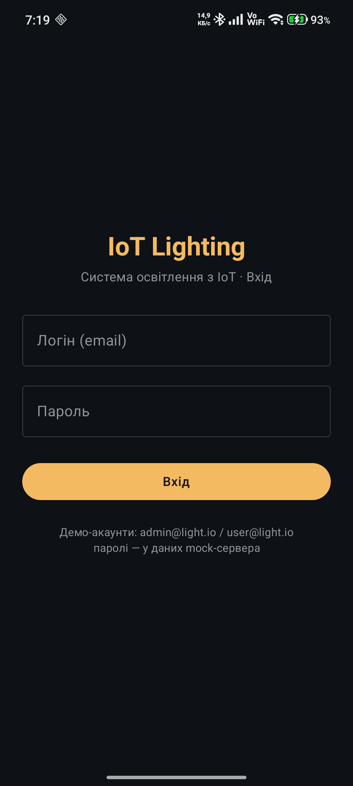
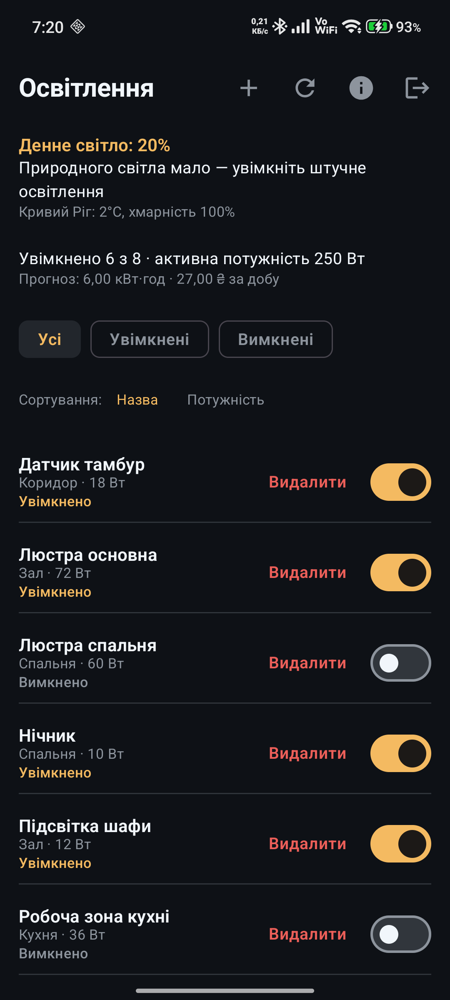
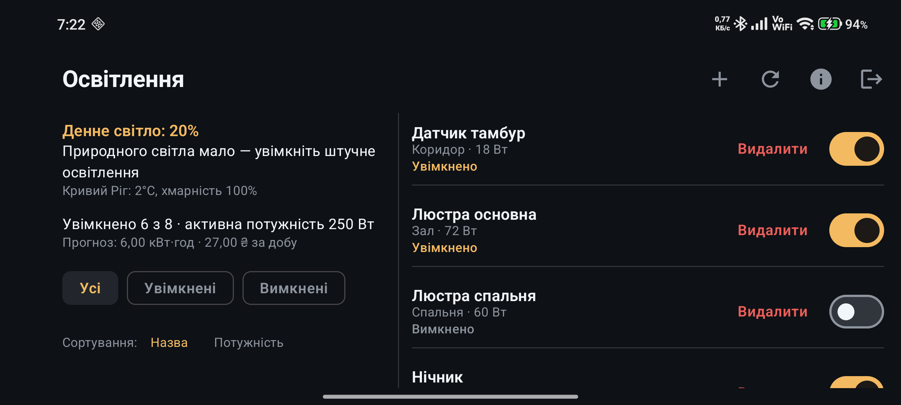
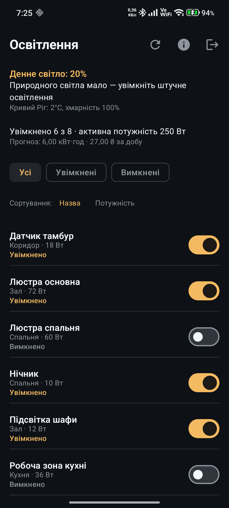
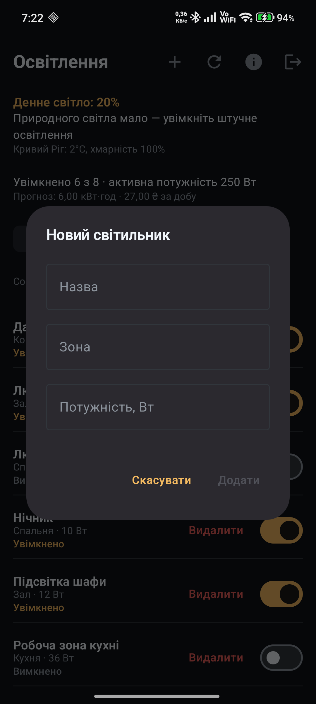
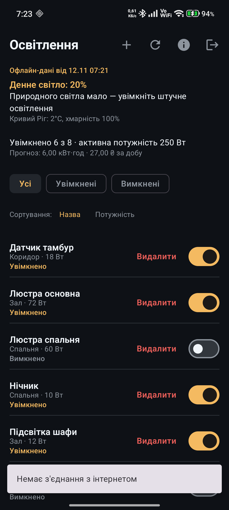

<div align="center">
  
# КП3 (Варіант 13): Система освітлення з IoT

[](https://vshymanskyy.github.io/StandWithUkraine/)

</div>

Android-застосунок для керування освітленням із зовнішнім REST-сервером: Repository і Data Source, кеш Room з офлайн-режимом, Retrofit і Gson, автентифікація тестовим токеном, обробка помилок мережі.

Практична робота №3 (заняття 9–12) з курсу «Розробка програмного забезпечення мобільних пристроїв». КПІ ім. Ігоря Сікорського, варіант 13: «Система освітлення з IoT».

## Можливості

- Список світильників із сервера: назва, зона, потужність, стан живлення. Синхронізація з кешем Room.
- Офлайн-режим: якщо сервер недоступний, показується кеш із позначкою часу останньої синхронізації.
- Керування: перемикання живлення (PUT), додавання (POST) і видалення (DELETE) світильників. Операції зміни складу доступні лише адміністратору.
- Автентифікація: вхід за обліковими даними з mock-сервера, тестовий JWT-подібний токен, Bearer-заголовок через Interceptor, перевірка терміну дії та ролі.
- Рекомендація за погодою: Open-Meteo віддає температуру, хмарність і ознаку дня для Кривого Рогу; застосунок радить, чи потрібне штучне освітлення.
- Обробка помилок: перевірка зʼєднання до запиту, різні повідомлення для HTTP-кодів, повтор запитів для тимчасових збоїв, журнал у `error_log.txt`.
- Адаптивний інтерфейс: портрет із обмеженням ширини 720 dp, ландшафт із двома панелями.

## Скріншоти

| Вхід | Список адміністратора | Ландшафт |
|:---:|:---:|:---:|
|  |  |  |

| Список користувача | Додавання | Офлайн-кеш |
|:---:|:---:|:---:|
|  |  |  |

Решта знімків (валідація, видалення, помилки 500 і 403, завершена сесія, «Про застосунок») лежить у [`docs/screenshots`](docs/screenshots).

## Технології

| Шар | Рішення |
|---|---|
| Мова | Kotlin 2.2.10 |
| UI | Jetpack Compose, Material 3, власна темна тема |
| Стан | ViewModel 2.11.0, StateFlow |
| Дані | Room 2.8.5, KSP 2.2.10-2.0.2, експорт схеми в JSON |
| Мережа | Retrofit 3.0.0, Gson, OkHttp із Bearer-Interceptor |
| Автентифікація | тестовий JWT-подібний токен, SharedPreferences |
| Асинхронність | Kotlin Coroutines 1.10.2 |
| Збірка | AGP 9.4.1, Gradle 9.6.0, minSdk 30, compileSdk 37, targetSdk 37 |
| Тести | JUnit4, kotlinx-coroutines-test, Room in-memory |

Архітектура: MVVM + Repository + Data Source. Одна Activity, ручний `AppContainer` без Hilt, два віддалені джерела (mock REST і Open-Meteo) та кеш Room.

## Структура

```
app/src/main/java/ua/kpi/iot_lighting/prac3/
├── data/
│   ├── auth/        токен, його розбір і зберігання, Interceptor
│   ├── error/       ErrorHandler, файловий журнал, перевірка мережі
│   ├── local/       Room: entity, DAO, база, метадані кешу
│   ├── remote/      Retrofit: сервіси, DTO, конфігурація
│   ├── repository/  реалізації репозиторіїв, повтор запитів
│   └── source/      Data Source: Room, mock REST, Open-Meteo
├── di/              AppContainer
├── domain/          моделі, інтерфейси репозиторіїв, бізнес-логіка, валідація
└── ui/              екрани, компоненти, тема, ViewModel
```

Схема Room зберігається в `app/schemas/1.json`.

## Mock-сервер

Дані віддає невеликий сервер на Python (`tools/mock_server.py`). Він тримає вісім світильників і два облікові записи, зберігає стан у `tools/server_state.json` і перевіряє Bearer-токен на `/lights`.

```bash
python tools/mock_server.py          # або подвійний клік на run_server.bat
adb reverse tcp:8080 tcp:8080        # телефон бачить сервер як 127.0.0.1:8080
```

Демо-акаунти: `admin@light.io` / `admin123` (адміністратор), `user@light.io` / `user123` (користувач). Паролі лежать у даних сервера відкритим текстом, це частина навчального завдання.

Для демонстрації обробки помилок створіть поруч `tools/fault_mode.json`, наприклад `{"GET_LIGHTS": 500}`. Сервер повертатиме цей код, поки файл існує; приберіть файл, щоб повернутися до штатної роботи. Дозволені ключі: `GET_LIGHTS`, `POST_LIGHTS`, `PUT_LIGHTS`, `DELETE_LIGHTS`.

Без `adb reverse` можна вказати LAN-адресу компʼютера в `ServerConfig.LIGHTING_BASE_URL` і додати її в `res/xml/network_security_config.xml`.

## Збірка

Потрібен Android SDK 37 і JDK 25. Gradle підтягне потрібний JDK через foojay, якщо його немає локально.

```bash
./gradlew assembleDebug
```

APK зʼявиться в `app/build/outputs/apk/debug/app-debug.apk`.

## Тести

```bash
./gradlew testDebugUnitTest          # 71 модульний тест
./gradlew connectedDebugAndroidTest  # 7 тестів на пристрої або емуляторі
```

Модульні тести покривають бізнес-логіку світла, валідацію входу, токен і термін дії, мапінг HTTP-кодів, повтор запитів, репозиторії, погоду, обидві ViewModel і мапери. Інструментальні перевіряють DAO кешу (3) і сховище токена (4).

## Обмеження

- Роль перевіряється на клієнті: сервер валідовує формат і термін токена, але не права адміністратора.
- Токен і паролі демо-акаунтів зберігаються відкритим текстом (SharedPreferences і дані сервера).
- Mock-сервер працює локально й потребує `adb reverse` або LAN-адреси.
- Застосунок має лише українську локалізацію.

## Автор

Недяк Олександр Сергійович, група ТВ-32. Кафедра інженерії програмного забезпечення в енергетиці, КПІ ім. Ігоря Сікорського, 2026.
